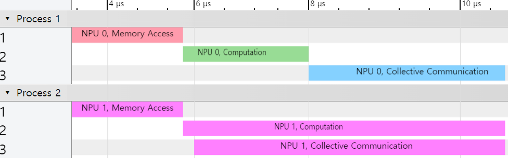

# Chakra User Guide
## Installation
### Step 1: Set up a Virtual Environment
It's advisable to create a virtual environment using Python 3.11 or later.

```bash
# Create a virtual environment
$ python3 -m venv chakra_env

# Activate the virtual environment
$ source chakra_env/bin/activate
```

### Step 2: Install Chakra
With the virtual environment activated, install the Chakra package using pip.

**Note:** If you previously installed Chakra from source, run `pip uninstall chakra` first.
The distribution is now named `mlc-chakra` but still provides the `chakra` import package,
so having both installed leaves two distributions owning the same files.
```bash
# Install package from PyPI
$ pip install mlc-chakra

# Install package from source
$ pip install .

# Install latest from GitHub
$ pip install https://github.com/mlcommons/chakra/archive/refs/heads/main.zip

# Install specific revision from GitHub
$ pip install https://github.com/mlcommons/chakra/archive/ae7c671db702eb1384015bb2618dc753eed787f2.zip
```

### Step 3: Uninstalling Chakra
To uninstall Chakra, use the following command within the virtual environment.

```bash
$ pip uninstall mlc-chakra
# If you installed a pre-rename build, also: pip uninstall chakra
```

### Alternative: install with uv
[uv](https://docs.astral.sh/uv/) can replace `venv` and `pip`. The steps are the same as above.

```bash
$ uv venv --python 3.11
$ source .venv/bin/activate
$ uv pip install mlc-chakra
```

To uninstall Chakra, run `uv pip uninstall mlc-chakra`.

## Tools Overview
### Execution Trace Link (chakra_trace_link)
Merge Chakra host execution trace and Chakra device execution trace to encode GPU operators into the output execution trace.
```bash
$ chakra_trace_link \
    --chakra-host-trace /path/to/chakra_host_trace \
    --chakra-device-trace /path/to/chakra_device_trace \
    --rank [RANK] \
    --output-file /path/to/chakra_host_device_trace.json \
    [--log-level LEVEL]
```
* --log-level: (Optional) Log verbosity: DEBUG, INFO (the default), WARNING or ERROR.

### Execution Trace Converter (chakra_converter)
Converts the execution traces from `chakra_trace_link` into traces in the protobuf format. It is responsible for identifying and encoding dependencies for simulation as well. The converter is designed for any downstream simulators that take Chakra execution traces in the protobuf format. It takes an input file in another format and generates a Chakra execution trace output in the protobuf format.
```bash
$ chakra_converter PyTorch \
    --input /path/to/chakra_host_device_trace.json \
    --output /path/to/chakra_trace \
    [--simulate] \
```
* --input: Path to the input file containing the merged Chakra host and device traces in JSON format.
* --output: Path to the output file where the converted Chakra trace will be saved in protobuf format.
* --simulate: (Optional) Enable simulation of operators after the conversion for validation and debugging purposes. This option allows simulation of traces without running them through a simulator. Users can validate the converter or simulator against actual measured values using tools like chrome://tracing or https://perfetto.dev/. Read the duration of the timeline and compare the total execution time against the final simulation time of a trace. Disabled by default because it takes a long time.

### Host traces read by chakra_trace_link and chakra_converter
Both tools read Chakra host traces (PyTorch execution traces) with the same parser, whether the trace comes straight from PyTorch or from `chakra_trace_link`.
* **PyTorch versions:** traces from PyTorch 2.2 or later (schema `1.0.2` and later, for example `1.1.1-chakra.0.0.4`). PyTorch 2.0 and 2.1 wrote an older format, which both tools reject with an error. A schema newer than the newest one Chakra knows is read with the newest known rules, after a warning.
* **Compressed traces:** a path ending in `gz` is read as gzip-compressed JSON, by both tools. `chakra_trace_link` also writes gzip-compressed JSON when `--output-file` ends in `gz`.
* **Errors** name the file, the node id and what is missing, for example `node 13 (aten::normal_): missing attribute(s) tid, which chakra_converter needs`.
* **A trace without a thread root** (a node named `[pytorch|profiler|execution_trace|thread]`) converts to an `.et` without nodes; the converter warns about it.

Changes from earlier versions of Chakra:
* `pip install` alone is enough: the separate PARAM install is no longer needed.
* `chakra_trace_link --log-level` works; it had no effect before. The linker logs in Python's default format.
* The converter reads schemas `1.0.4` and `1.1.1-chakra.1.0.0`, and newer schemas with a warning. `chakra_trace_link` rejects PyTorch 2.0 and 2.1 traces, as the converter already did.
* `chakra_trace_link` no longer rejects a trace that lacks node attributes it does not use (such as `tid`), and no longer hangs on a node that is its own ancestor.
* A trace with two nodes of the same id is rejected; before, the later node silently replaced the earlier one.
* The PyTorch 2.0 thread-root name `[pytorch|profiler|execution_graph|thread]` is no longer recognised; such traces (schema 1.0.1) are rejected anyway.
* A trace file is read as gzip when its name ends in `gz`. A name that doesn't match the content is an error that says so.
* `chakra_trace_link --output-file` ending in `gz` writes gzip-compressed JSON; before, it wrote plain JSON under that name.
* For valid traces, the output of both tools is unchanged.

### Running Execution Traces on ASTRA-sim
Chakra execution traces in the protobuf format can be run on ASTRA-sim, which reads them with its own built-in feeder.
* ASTRA-sim repository: https://github.com/astra-sim/astra-sim
* ASTRA-sim setup instructions: https://astra-sim.github.io/astra-sim-docs/getting-started/setup.html

The C++ feeder that was previously part of this repository has been removed.

### Execution Trace Visualizer (chakra_visualizer)
This tool visualizes execution traces in various formats. Here is an example command:

```bash
$ chakra_visualizer \
    --input_filename /path/to/chakra_et
    --output_filename /path/to/output.[graphml|pdf|dot]
```

### Execution Trace Jsonizer (chakra_jsonizer)
Provides a readable JSON format of execution traces:

```bash
$ chakra_jsonizer \
    --input_filename /path/to/chakra_et \
    --output_filename /path/to/output_json
```

### Timeline Visualizer (chakra_timeline_visualizer)
Visualizes the execution timeline of traces. This tool serves as a reference implementation for visualizing the simulation of Chakra traces. After simulating Chakra traces, you can visualize the timeline of operator executions. Update the simulator to present when operators are issued and completed. Below is the format needed:
```csv
issue,<dummy_str>=npu_id,<dummy_str>=curr_cycle,<dummy_str>=node_id,<dummy_str>=node_name
callback,<dummy_str>=npu_id,<dummy_str>=curr_cycle,<dummy_str>=node_id,<dummy_str>=node_name
...
```

You can visualize the timeline with the command below.
```bash
$ chakra_timeline_visualizer \
    --input_filename /path/to/input.csv \
    --output_filename /path/to/output.json \
    --num_npus 4 \
    --npu_frequency 1.5GHz
```

When you open the output file with `chrome://tracing`, you will see an execution timeline like the one below.

