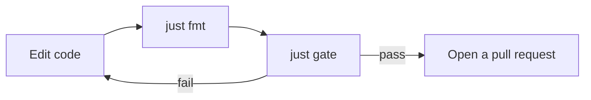

# Development guide

This guide is for people who change the Chakra code. It shows how to set up your computer, check a change, and run the CI workflows there.
If you only want to use Chakra, read the [User Guide](../USER_GUIDE.md).

## Terms

| Term | Meaning |
|---|---|
| gate | The full set of local checks. `just gate` runs it. It has the Python checks of CI, and more. |
| recipe | One task in the `justfile`, for example `just lint`. |
| virtual environment | The Python 3.11 install in `.venv/` that `uv` makes. |
| lock file | `uv.lock`. It records the exact version of every package. |
| workflow | One file in `.github/workflows/`. GitHub Actions runs it. |
| act | A tool that runs a workflow in Docker on your computer. |

## What you need

| Tool | Needed for | Install on macOS |
|---|---|---|
| [uv](https://docs.astral.sh/uv/) | Python, the virtual environment, the dependencies | `brew install uv` |
| [just](https://just.systems/) | The recipes | `brew install just` |
| [Docker](https://docs.docker.com/get-started/get-docker/) | `just act` and `just ci-github-lint` | Docker Desktop or OrbStack |
| [act](https://nektosact.com/) | `just act` only | `brew install act` |

On Linux, see the install page of each tool.

## Windows

The recipes and the scripts in `scripts/` need bash. On Windows, use WSL2. Then follow the steps for Linux in this guide.

Native Windows is not supported. We tested these steps on macOS and in a WSL instance of Debian 13 (trixie). If a step fails on Windows, tell us which step and the first error.

## Set up

Run these commands in the repository folder.

```bash
just setup
just gate
```

`just setup` installs Python 3.11 and the development tools. `just gate` must pass before you start to change code.

## Daily steps



## Recipes

Run `just` to see the list.

| Recipe | What it does | CI workflow it matches |
|---|---|---|
| `just setup` | Installs the virtual environment. | - |
| `just fmt` | Formats the code. Fixes the lint errors that ruff can fix. | - |
| `just lint` | Checks the format, runs ruff, and runs vulture. | `python_lint.yml` |
| `just lint-scripts` | Lints the shell scripts in `scripts/` with shellcheck. | - |
| `just types` | Type checks with pyright. | `python_lint.yml` |
| `just test` | Runs the unit tests. Add pytest options after the name, for example `just test -k trace_link`. | `python_tests.yml` |
| `just test-slow` | Runs the slow tests. They need a network. They build the package as an editable install, and as a wheel that has a file left out. They also check that `just proto-check` catches a changed `.proto` file. | - |
| `just gen-proto` | Generates the protobuf modules in `schema/protobuf/` from the `.proto` files. It needs a network. | - |
| `just proto-check` | Generates the protobuf modules in a temporary folder and compares them with the committed ones. It writes nothing. | `python_tests.yml` |
| `just proto-smoke` | Imports the generated protobuf modules with the newest and the oldest allowed protobuf. | `python_tests.yml` |
| `just wheel-check` | Builds the wheel from a clean copy and installs it (not editable) in a new temporary virtual environment. Checks the wheel files, imports the protobuf modules with two protobuf versions, and starts the commands. The other checks use the editable install. | `python_tests.yml`, `end_to_end_tests.yml` |
| `just lock-check` | Checks that `uv.lock` matches `pyproject.toml`. It fails when they differ. `uv run` and `uv sync` would change an old `uv.lock` without a warning. | - |
| `just gate` | Runs all the checks above. | - |
| `just act` | Runs one workflow in Docker. Add a file name from `.github/workflows/`. The default is `python_lint.yml`. | - |
| `just ci-github-lint` | Lints the workflow files with actionlint in Docker. It fails today, because the workflows use old actions (`checkout@v2`, `setup-python@v2`). It is not part of the gate. | - |

## The lock file

`uv.lock` is in the repository. It records the exact version of every package, for Python 3.11 and later on all systems. `just setup` and `uv run` use it, so everyone gets the same packages.

When you change `dependencies` or `[dependency-groups]`, run `uv lock` and commit the new `uv.lock`. `just lock-check` shows if you forgot.

## Git blame

A commit that only formats code hides the real author of each line in `git blame`. The file `.git-blame-ignore-revs` lists such commits. GitHub reads it by itself. Tell your local git once:

```bash
git config blame.ignoreRevsFile .git-blame-ignore-revs
```

After a commit that formats many files, add its full hash to the file.

## Common tasks

| Task | How |
|---|---|
| Change a `.proto` file | Run `just gen-proto`, then commit the changed `*_pb2.py` and `*_pb2.pyi` files. Without `just`, run `scripts/gen_proto.sh`. CI fails when you forget. |
| Add a runtime dependency | Add it to `dependencies` in `pyproject.toml`. Run `uv lock`, and commit `uv.lock`. |
| Add or change a development tool | Change `[dependency-groups]` in `pyproject.toml` and `requirements-dev.txt`. Run `uv lock`, and commit `uv.lock`. `just test` fails when the two files differ. |
| Fix a conflict in `uv.lock` | Do not merge it by hand. Take the file from `main`, for example with `git checkout origin/main -- uv.lock`. Then run `uv lock`. |
| Read a host trace in Python | Use `HostTrace.from_file` in `src/host_trace/trace.py`. `chakra_trace_link` and `chakra_converter` both use it. |
| Support a new PyTorch trace format | Add an entry to `FORMAT_CHANGES` in `src/host_trace/versions.py`: the version, the PyTorch release and the keys that each node gains. A new schema number without a format change needs no change. |

## Run the CI workflows on your computer

Use `just act <file>`, for example `just act python_tests.yml`. The file is a name in `.github/workflows/`. It runs the workflow in a Docker container. After the first run, which downloads a large image, a run takes about 15 to 40 seconds.

Use it when you change a workflow file. For a code change, `just gate` is faster.

Each run starts with an empty tool cache. `scripts/act.sh` first removes the shared `act` cache volume and the `act` containers that use it. It does not touch other Docker containers. It refuses to start while another `act` run is active on your computer. It needs `pgrep` for that check.

`act` uses a copy of your working folder, with your uncommitted changes. It is not exactly GitHub. On Apple silicon, `act` runs arm64 containers, and GitHub runs x86_64. A green `act` run does not replace the check on your pull request.

| Workflow | Result with `just act` |
|---|---|
| `python_lint.yml` | Works. |
| `python_tests.yml` | Works. |
| `end_to_end_tests.yml` | Works. |
| `codeql.yml`, `cla.yml` | Not run. They need GitHub services. |
| Any other workflow | Not tested. |

Tested with OrbStack on an Apple silicon Mac (November 2026). Docker Desktop is not tested. If `just act` fails there with a "mkdir ... operation not supported" error, open an issue.

## Shell scripts

Shell scripts live in `scripts/`. `just lint-scripts` checks them with shellcheck. The tests in `tests/test_scripts.py` run each script with fake `docker`, `act`, and `uv` programs. They need neither Docker nor a network, except the slow tests.

## The classic setup

The `pip` setup still works. Use Python 3.11, the version that CI uses.

```bash
python3.11 -m venv .venv
source .venv/bin/activate
pip install .
pip install -r requirements-dev.txt
python -m pytest tests
ruff format --check . && ruff check . && pyright && vulture src/ tests/
```

`pip install .` is not an editable install. Run it again after you change code. `pip` does not read `uv.lock`.

After you change a `.proto` file, run `scripts/gen_proto.sh` and commit the result. It needs only Python and a network. `scripts/gen_proto.sh --check` compares without writing. The script uses `python3`. To use another Python, set `PYTHON`, for example `PYTHON=python3.11 scripts/gen_proto.sh`.

## Python version

`just` runs `uv` with Python 3.11, the version that CI uses. `uv` installs it for you. If you run `uv` yourself, add `--python 3.11`.

We do not ship a `.python-version` file. Your pyenv or mise setup stays as it is.

## Secrets

`act` can read the files `.secrets`, `.env`, and `.vars`. Git ignores them. Never commit them.
